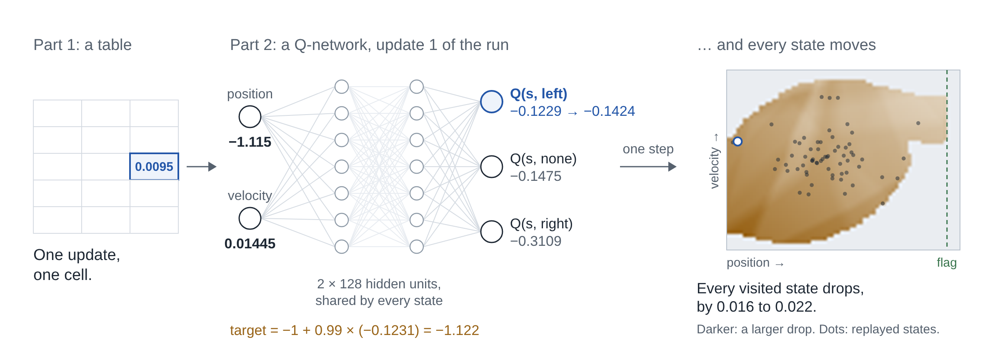
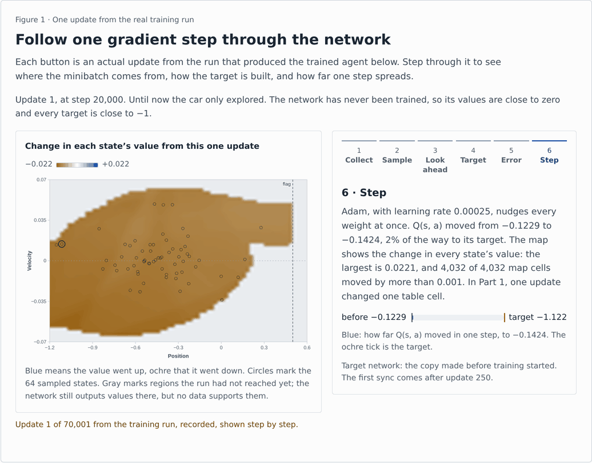
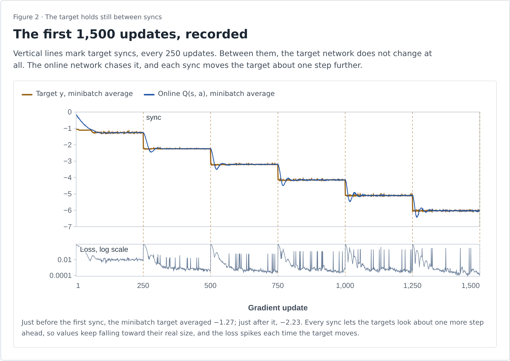
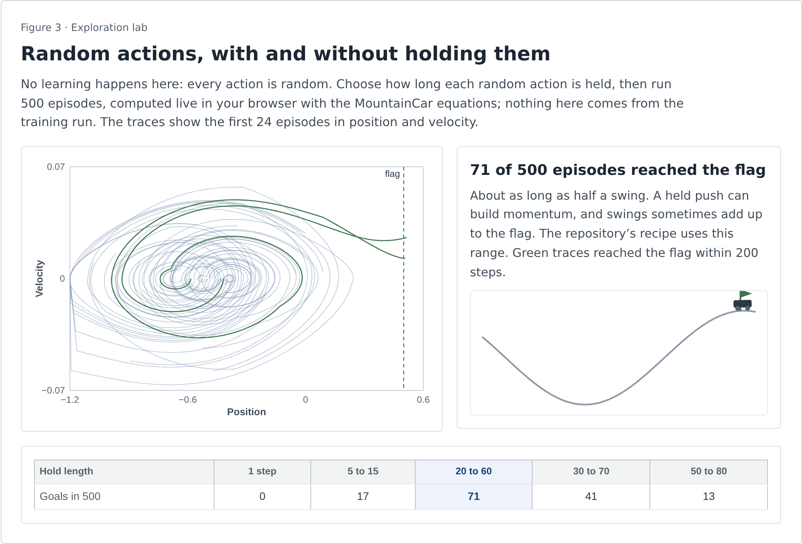
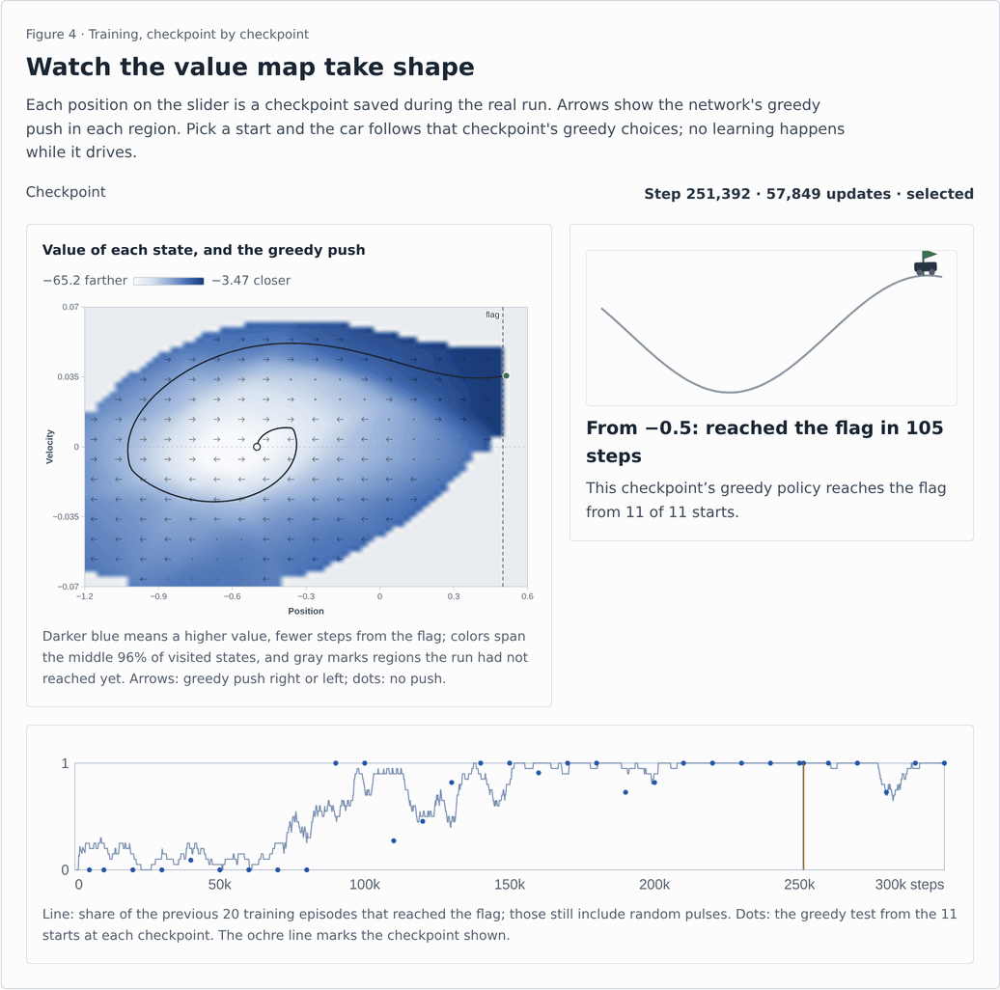
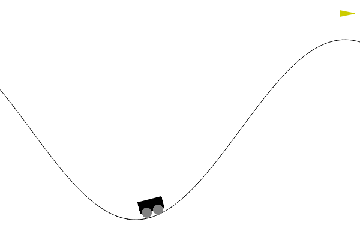

# DQN: when a table is not enough



*From a lookup table to a neural network, followed through one real gradient step. Part 2 of [RL From Zero](https://medium.com/@a.shamsoshoara/rl-from-zero-reinforcement-learning-built-from-scratch-6f7472215597).*

[Part 1](https://medium.com/@a.shamsoshoara/q-learning-watch-a-table-learn-one-experience-at-a-time-82f20585f257) ended with one picture to keep: an experience arrives, the agent builds a target, and a prediction moves toward it. In FrozenLake you could point to the exact table cell that moved.

This part keeps that picture and removes the cell.

The task is MountainCar. The agent still learns action values, and its target is still a reward plus the best value it expects next. But the values now come out of a small neural network, and one update moves the whole network. That single change brings two new problems, and DQN is mostly the pair of fixes for them.

Every number below comes from the actual training run behind the trained agent at the end of this article. The [interactive version](https://alirezashamsoshoara.github.io/blog/rl-from-zero/dqn/) lets you step through those recorded updates and drive the car with every saved checkpoint.

## A state you cannot put in a table

A car sits in a valley between two hills. The flag is on top of the right hill, and the engine is too weak to drive straight up. The only way out is to rock back and forth: go up the left slope, roll down, and use that speed to climb the right one.

```text
state      position in [-1.2, 0.6], velocity in [-0.07, 0.07]
start      position in [-0.6, -0.4], velocity 0
actions    push left, no push, push right
reward     -1 every step
ends       flag reached (position >= 0.5), or 200 steps pass
```

Every step costs −1, including the step that reaches the flag, so fewer steps means a better return.

In FrozenLake, the agent visited the same 16 squares again and again, and each had its own row in the table. Here, position and velocity are real numbers. The car almost never lands on exactly the same state twice.

You could chop the map into cells and keep a table anyway. But then each cell learns alone: a correction near one state teaches its neighbors nothing, even though a car at position −0.501 and one at −0.500 are in nearly the same situation. What we want is a function that gives similar answers for similar states.

## Replace the table with a function

DQN keeps the Q-learning target and swaps the table for a neural network that takes a state and returns one value per action:

```text
Q(s, a; theta)  ~  expected return after action a in state s
```

Here *theta* is the network's weights. In this run the two inputs are rescaled to the range −1 to 1, then pass through two hidden layers of 128 units each, then out to three values. That is 17,283 weights and biases, and **every one of them is shared by every state**.

The target from Part 1 survives almost unchanged. What changes is how a prediction moves toward it. A table could nudge one cell. A network can only adjust its weights, so the update becomes a small step of gradient descent on the squared gap:

```text
target = r + gamma * (1 - terminated) * max_a' Q(s', a'; theta)
loss   = (target - Q(s, a; theta))^2
theta  <- theta - learning_rate * gradient of loss
```

The target is treated as a fixed number: no gradient flows through it. In practice the run averages the loss over a minibatch of 64 transitions and uses the Adam optimizer.

Because every state shares the same weights, that step changes the value of states the update never looked at. That is the point of using a network. It is also the source of the trouble.

## One real update, by hand

Here is the very first gradient update of the run, at step 20,000. Until then the car only explored at random. The network has never been trained, so its outputs are small numbers near zero.

The update draws 64 stored transitions. Follow one of them: stored 3,606 steps earlier, the car was on the left slope at position −1.115, moving right at 0.0145, and the stored action was push left.

DQN in this run uses the Double DQN target, which splits the look-ahead in two. The online network, the one being trained, chooses the next action. A second copy, the **target network** with weights *theta⁻*, scores it:

```text
a*     = argmax_a' Q(s', a'; theta)
target = r + gamma * (1 - terminated) * Q(s', a*; theta-)
```

At the next state, the online network's three values are −0.1231 (left), −0.1478 (none) and −0.3092 (right), so it picks left. Before the first sync, the target network is an exact copy, so it also scores left at −0.1231:

```text
target   = -1 + 0.99 * (1 - 0) * (-0.1231) = -1.122
TD error = -1.122 - (-0.1229) = -0.999
```

After one Adam step, Q(s, left) has moved from −0.1229 to −0.1424. That is about 2% of the way to the target: the step averages 64 samples, and a learning rate of 0.00025 asks for a small move.



*One recorded update, opening on its result: the change in value across the whole position and velocity map. Then it steps through collect, look ahead, target, error and step.*

Now look at the change map. One update changed the value of every one of the 4,032 cells on the map, by up to 0.022. In Part 1, one update changed exactly one cell.

A goal transition is the one place the target does not look ahead. Update 32 contains one, a step that crossed the flag at position 0.501. Its target is just the reward:

```text
target = -1 + 0.99 * (1 - 1) * (anything) = -1
```

Every other target bootstraps from the network itself, which is why reaching the flag at all matters so much here.

What does a value mean? If the car is T steps from the flag, its discounted return is −(1 − 0.99^T) / 0.01. A value near −63 means roughly 100 steps to go. A car that never reaches the flag approaches −100.

## Two problems a network brings

Part 1 warned that a network would bring two difficulties: updates that affect many states, and targets that move as the network learns. DQN answers each with one idea.

**Consecutive experience is nearly identical.** Within an episode, each state is a tiny step from the last. Training on experience in the order it arrives would keep pushing the shared weights toward the patch of the map the car is in right now. **Experience replay** stores the last 100,000 transitions and trains on a random minibatch of 64 every 4 steps. In five updates I checked, none of the 64 samples came from the episode the car was driving at the time. Over the whole run, each transition was sampled about 15 times on average.

**The target moves with every step.** The target is built from the network's own predictions. If the same weights produced both, every update would also move the target. The **target network** is a frozen copy that computes targets, refreshed from the online network every 250 updates:

```text
every 250 updates:  theta- <- theta
```



*Recorded from the run. Vertical lines mark target syncs.*

In the first 250 updates, the online network learns to predict the frozen targets, which drift to −1.27 by update 250: one step of cost plus a small guess. Then the copy lands. The targets jump to −2.23, because they now bootstrap from a network that has learned that one step costs about 1, and the loss jumps from 0.0084 to 0.94. Each sync lets the values look roughly one step further ahead. By about update 29,000, after about 115 syncs, the average target has fallen past −60. Later it rises again, to about −34 by the end of training, as the car reaches the flag in fewer steps.

**Why Double DQN?** Plain DQN lets the target network both choose and score the next action, with a max over its values. A max over noisy estimates tends to pick the ones that happen to be too high, so that target is biased upward. Double DQN chooses with the online network and scores with the target network. Because the target network lags behind, their errors only partly overlap, so the bias usually shrinks. It does not disappear, and nothing here measures how much it shrank.

## The update in code

These excerpts come from the [RL-from-zero DQN source, pinned to one revision](https://github.com/AlirezaShamsoshoara/RL-from-zero/tree/f1563be804410939adf0b45ff93fd6f09f589cc3/deepQN). They are excerpts, not standalone programs.

**Uniform replay, excerpt from `ReplayBuffer.sample`.** Every stored transition is equally likely, whatever its age.

```python
indices = np.random.randint(0, self.size, size=batch_size)
return {
    "obs": torch.as_tensor(self.obs[indices], device=self.device),
    "actions": torch.as_tensor(self.actions[indices], device=self.device),
    "rewards": torch.as_tensor(self.rewards[indices], device=self.device),
    "next_obs": torch.as_tensor(self.next_obs[indices], device=self.device),
    "dones": torch.as_tensor(self.dones[indices], device=self.device),
}
```

**One update, adapted from `DQNAgent.update`.** The batch checks, the non-finite-loss check and the returned statistics are omitted.

```python
obs, next_obs = self._encode(obs), self._encode(next_obs)
actions = actions_raw.long()
action_values = self.q_network(obs).gather(1, actions.unsqueeze(1)).squeeze(1)
with torch.no_grad():
    if self.double_dqn:
        next_actions = self.q_network(next_obs).argmax(dim=1, keepdim=True)
        next_target_values = (
            self.target_q_network(next_obs).gather(1, next_actions).squeeze(1)
        )
    else:
        next_target_values = self.target_q_network(next_obs).max(dim=1).values
    targets = rewards + self.gamma * (1.0 - dones) * next_target_values
loss = F.mse_loss(action_values, targets)
self.optimizer.zero_grad()
loss.backward()
if self.max_grad_norm > 0:
    nn.utils.clip_grad_norm_(self.q_network.parameters(), self.max_grad_norm)
self.optimizer.step()
self.train_steps += 1
if self.train_steps % self.target_update_interval == 0:
    self.update_target_network()
```

`gather` picks Q(s, a) for the action actually taken. Inside `no_grad`, the online network chooses and the target network scores, so no gradient flows into the target. The done mask comes only from true termination: a step cut off by the 200-step limit still looks ahead, because the task did not end, the clock did.

## The hard part: finding the flag at all

Until some transition reaches the flag, every target is "−1 plus a guess," and the network has nothing to learn except that time passes.

Reaching the flag by accident is hard. Random actions that change every step mostly cancel out, and the car jiggles near the bottom of the valley. What works is commitment: push one way long enough to build a swing, then the other. The repository's own probe ran 500 fully random episodes per setting. Independent random actions reached the flag 0 times. Holding each random action for 20 to 60 steps reached it 64 times, 30 to 70 steps 43 times, and 50 to 80 steps only 8 times.



*From the interactive version's exploration lab, which runs the MountainCar equations in the browser with its own random numbers, not the training run. With this seed, 71 of 500 episodes reached the flag.*

So the training recipe explores with **held random pulses**: with probability p, it starts a random action and keeps it for 20 to 60 steps; otherwise it takes the network's greedy action. In the first 20,000 steps every action is random, and in those 104 warm-up episodes the car reached the flag 20 times. After that, epsilon falls from 1 to 0.02 over the next 100,000 steps. Because a pulse lasts many steps, p cannot equal epsilon. With an average hold of H steps the code uses p = epsilon / (H(1 − epsilon) + epsilon), so that epsilon is roughly the fraction of random steps. When the trained agent is tested, it never holds an action.

## Watching training

The run saved a checkpoint every 5,000 steps. Here is the value map at one checkpoint every 10,000 steps, with the greedy policy's push shown as arrows.



*Saved checkpoints from the real run. Darker blue means a higher value, fewer steps from the flag; gray marks states the run had not reached.*

Two things stand out. The values take shape long before the policy works: the greedy car reaches the flag from at most 1 of 11 test starts until step 90,000, where it suddenly succeeds from all of them. And learning is not monotonic: at step 110,000 it reaches the flag from only 3 of 11, recovering by step 140,000. One likely cause is that shared weights let an improvement in one region damage another, while the targets keep moving. This is why the repository keeps checkpoints and selects one instead of trusting the last.

The network also outputs a value for every state, including fast-moving states near the walls that the car never reached. At the selected checkpoint, 156 unvisited cells have values above −1, which is impossible for a state that has not reached the flag. Where data is missing, a network's confident-looking number is a guess.

## The real repository run

Everything above comes from one run of the repository's recommended recipe, unchanged. Before using it, I re-ran that recipe with the locked dependencies on one CPU thread and compared all 61 saved checkpoints tensor by tensor. All 61 matched exactly, so the minibatches and targets above are the ones that trained this agent.



*The committed repository GIF, rendered by Gymnasium from the selected checkpoint with greedy actions. It shows the three highest-return episodes of eight, so it is a showcase, not a success rate.*

The selected checkpoint was saved at step 251,392, where the average return of the previous 20 training episodes peaked at −96.05. Evaluated greedily on 200 new starts, with no action holds and no filtering, it reached the flag in all 200, with a mean return of −100.46 and a standard deviation of 9.21, above the environment's −110 threshold for solving the task. Those starts vary the car's position, not the physics, and this is one training seed: the same seed's earlier recipes reached the flag 0 times.

To reproduce it, in a fresh environment:

```bash
git clone https://github.com/AlirezaShamsoshoara/RL-from-zero.git
cd RL-from-zero
git checkout f1563be804410939adf0b45ff93fd6f09f589cc3
uv venv .venv-dqn --python 3.12
source .venv-dqn/bin/activate
uv sync --active
WANDB_MODE=offline OMP_NUM_THREADS=1 MKL_NUM_THREADS=1 \
  uv run --active python -m deepQN.main train \
  --config deepQN/configs/mountaincar_exploration.yaml
```

## What these results do not show

- **A small loss is not a good policy.** The loss was 0.0071 after 100 updates, while greedy checkpoints from that stage reached the flag from none of the 11 test starts.
- **A value is not a chance of success.** It is a discounted sum of −1 rewards; −63 means about 100 steps to go.
- **Close is not calibrated.** The network's starting values average −66.31 against an actual discounted return of −63.25 on one set of test seeds: about 3 points pessimistic.
- **DQN has no convergence guarantee.** Function approximation, bootstrapping and off-policy data together, the combination Sutton and Barto call the deadly triad, can diverge. Replay and target networks often make it work in practice, though this repository's earlier recipes failed with both in place.
- **This is not an ablation.** The successful recipe changed input scaling, learning rate, target cadence, training length, exploration, warm-up and checkpoint selection at once.

## Next: learn how to act directly

DQN acts by taking the argmax over its value estimates, and it explores by mixing in random pulses from outside. Part 3 changes what the network learns: A3C trains a policy that outputs action probabilities directly, so exploration comes from sampling that policy, with a critic beside it and several workers learning in parallel instead of replaying old experience. Keep the picture: a prediction, a target, and one step toward it. The critic will look familiar.

## References and companion material

- [Interactive DQN companion](https://alirezashamsoshoara.github.io/blog/rl-from-zero/dqn/): step through recorded updates, the exploration lab, and every saved checkpoint.
- Mnih and colleagues, *Playing Atari with Deep Reinforcement Learning* (2013), [arXiv:1312.5602](https://arxiv.org/abs/1312.5602), and *Human-level control through deep reinforcement learning*, *Nature* (2015), [doi:10.1038/nature14236](https://doi.org/10.1038/nature14236).
- van Hasselt, Guez and Silver, *Deep Reinforcement Learning with Double Q-learning* (2016), [arXiv:1509.06461](https://arxiv.org/abs/1509.06461).
- Lin, *Self-improving reactive agents based on reinforcement learning, planning and teaching* (1992), [doi:10.1007/BF00992699](https://doi.org/10.1007/BF00992699), where experience replay comes from.
- Sutton and Barto, *Reinforcement Learning: An Introduction*, second edition, [the authors' book page](http://incompleteideas.net/book/the-book-2nd.html); Section 11.3 names the deadly triad.
- [Pinned RL-from-zero DQN source](https://github.com/AlirezaShamsoshoara/RL-from-zero/blob/f1563be804410939adf0b45ff93fd6f09f589cc3/deepQN/dqn/agent.py) and [Gymnasium MountainCar documentation](https://gymnasium.farama.org/environments/classic_control/mountain_car/).
