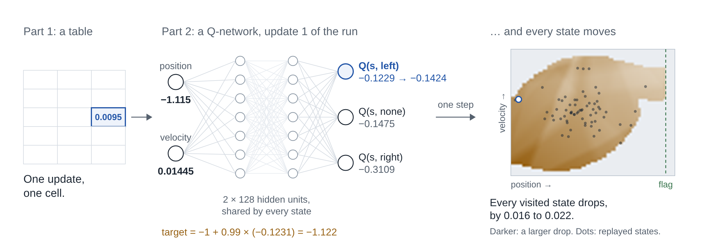
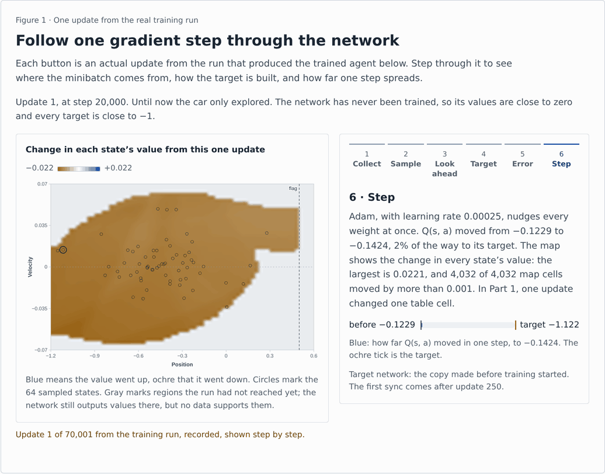
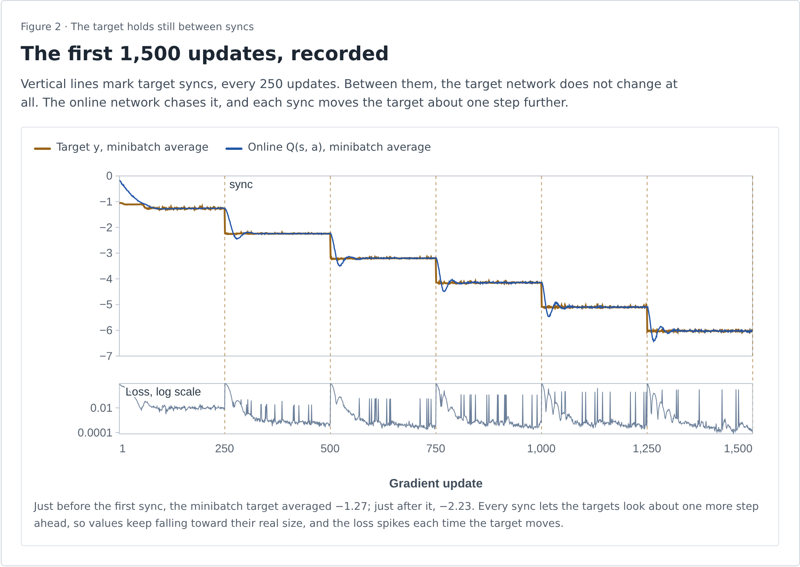
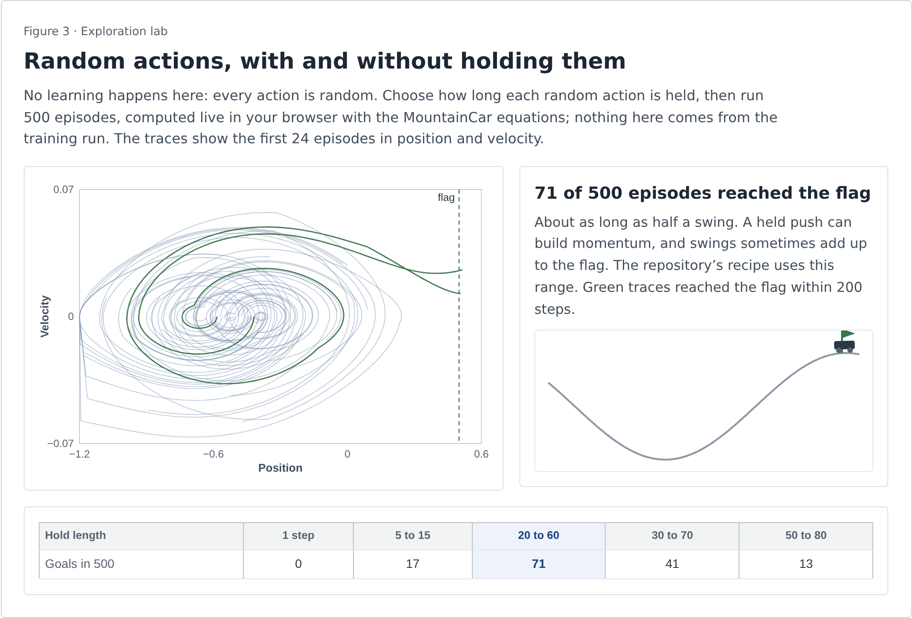
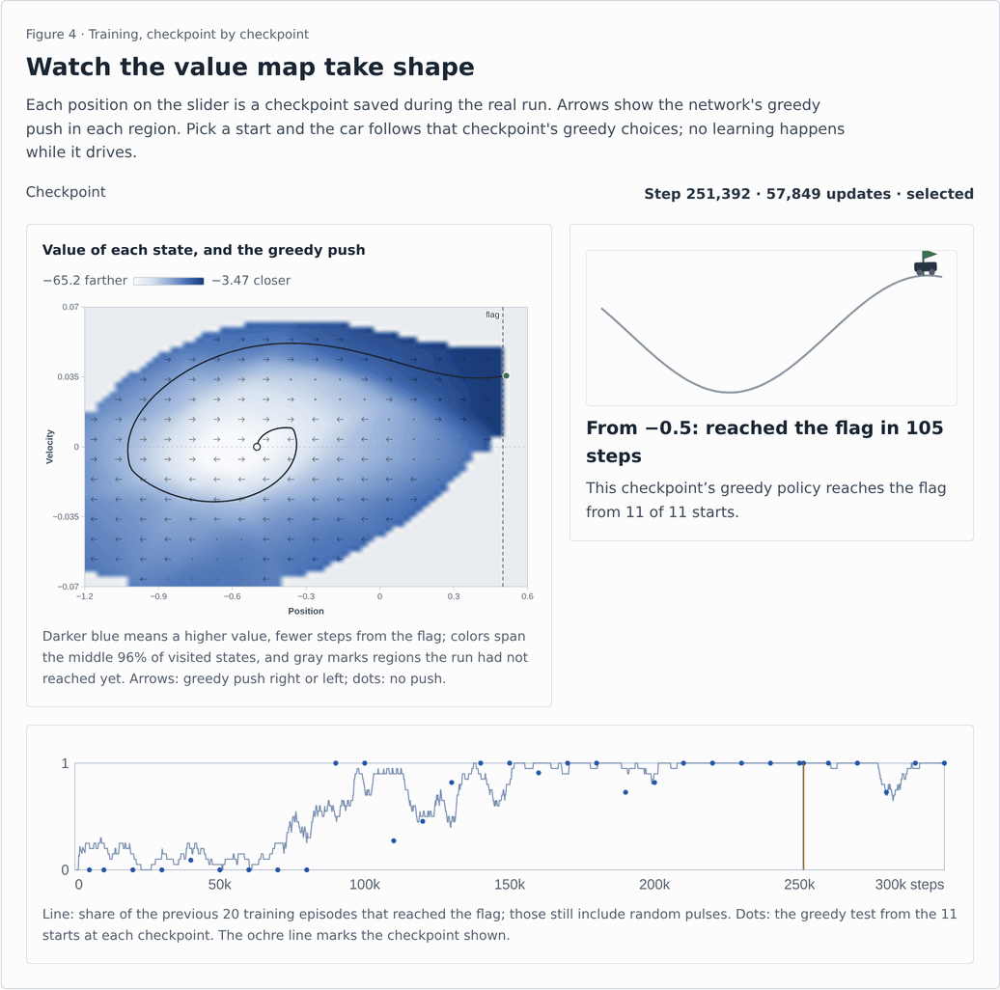
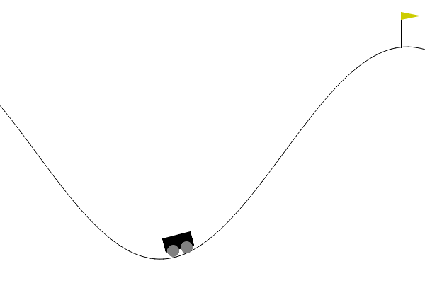

# DQN: when a table is not enough

*One real gradient step, followed from a stored experience to a change in every state's value. Part 2 of [RL From Zero](https://ali1956283.substack.com/p/introducing-rl-from-zero).*

Last time, a table learned to cross a frozen lake.

In [Part 1](https://ali1956283.substack.com/p/q-learning-how-a-table-learns-from), every experience moved exactly one number. The agent stepped from state 13 to state 14, built a target, and nudged one cell of its table from 0 to 0.0095. You could point to it.

This week the table goes away.

The task is MountainCar: a car stuck in a valley, an engine too weak to drive up the hill, and a flag at the top. The agent still learns how good each action is. It still builds a target from a reward and its own guess about what comes next. But the guesses now come from a small neural network, and that changes what a single update does. It is also why DQN needs two extra ideas to work at all.

Everything below comes from the real training run behind the trained agent at the end. The [interactive version](https://alirezashamsoshoara.github.io/blog/rl-from-zero/dqn/) lets you step through the recorded updates yourself.

## Why the table has to go

The car's state is two numbers: its position, between −1.2 and 0.6, and its velocity, between −0.07 and 0.07. Each step it can push left, push right, or not push. Every step costs −1, so a shorter trip to the flag is a better result. An episode ends at the flag, or after 200 steps.

The only way up is to rock: climb the left slope, roll down, and use that speed on the right one.

In FrozenLake there were 16 squares, and the agent visited them over and over. Here, position and velocity are real numbers. The car almost never lands on exactly the same state twice, so a table would see almost every entry once.

What we need is a function that treats similar states similarly. A car at position −0.501 should learn from a car at −0.500.

## A network instead of a table

DQN replaces the table with a neural network. You give it a state; it gives back three numbers, one value for each action.

This network is small: two inputs, two hidden layers of 128 units, three outputs. That is 17,283 weights and biases, and every one of them is shared by every state.

The target is the same one from Part 1, the reward plus the discounted value of the best next action. A table moved one cell toward that target. A network can only move its weights, so it takes a small gradient step that reduces the squared gap between its prediction and the target, holding the target fixed while it does.

Because the weights are shared, that step changes the network's answer for states it never looked at. That is exactly what we wanted. It is also the source of the trouble.

## One real update, worked by hand

Here is the very first update of the run, at step 20,000. Before that, the car only explored at random, and the network never trained.

The update takes 64 stored experiences at once. Follow one: the car was on the left slope, at position −1.115, moving right at 0.0145, and it pushed left.

To build the target, DQN looks one step ahead, in two parts. The network being trained picks the best next action: its three values at the next state are −0.1231 for left, −0.1478 for no push and −0.3092 for right, so it picks left. A second, frozen copy of the network, the target network, then scores that choice. Before training starts the copy is identical, so it also says −0.1231.

The target is the reward plus the discounted score: −1 + 0.99 × (−0.1231) = −1.122.

The network's current guess for pushing left was −0.1229, so the error is −1.122 − (−0.1229) = −0.999. After one step of the Adam optimizer, the guess moves to −0.1424, about 2% of the way to the target. Small steps are deliberate: the update averages all 64 experiences, and the learning rate is 0.00025.

*One recorded update. The first frame is its result: the change in value across the whole position and velocity map. Darker means a bigger drop.*

Here is the part that surprised me the first time. That one step changed the value of every one of the 4,032 cells on the map, by up to 0.022. In Part 1, one update changed one cell.

One kind of experience does not look ahead at all: reaching the flag. Update 32 includes a step that crossed the flag at position 0.501. Its target is simply the reward, −1, because nothing comes after the goal. These transitions are the only places where the values are tied to something real. Everything else is the network leaning on its own guesses.

A quick way to read the values: each step costs 1, discounted by 0.99, so a car about 100 steps from the flag has a value near −63, and a car that never gets there approaches −100.

## Two problems, two fixes

Updating a network with its own guesses brings two problems.

**Problem one: experience comes in streaks.** Within one episode, each state is a tiny step from the last. Training on experience in order would keep pulling the shared weights toward wherever the car happens to be, and the rest of the map would drift. DQN keeps a **replay buffer**, the last 100,000 transitions, and trains on a random handful of 64 every 4 steps. In the updates I followed, none of the 64 came from the episode the car was driving at the time. Each transition ends up being reused about 15 times on average.

**Problem two: the target moves.** If the same network produced both the guess and the target, every update would also move the target, and learning would chase its own tail. DQN builds targets with a **frozen copy** of the network instead, and refreshes that copy every 250 updates.

*Recorded from the run. Each vertical line is a refresh of the frozen copy.*

You can see it in the first 250 updates. The targets drift to −1.27, one step of cost plus a small guess. Then the copy is refreshed, and the targets jump to −2.23: the frozen network has now learned that a step costs about 1. The error jumps too, from 0.0084 to 0.94, and the chase starts over. Each refresh lets the values look about one step further ahead. After about 115 refreshes they pass −60.

The run also uses **Double DQN**, the split you saw in the worked example: one network picks the next action and the other scores it. A single network choosing and scoring with a max tends to pick its own lucky overestimates. Splitting the roles usually shrinks that bias, though it does not remove it.

## The hard part: finding the flag

None of this works until the car reaches the flag at least sometimes. Until then, every target says "it costs −1, plus whatever I guessed," and there is nothing real to learn.

Random actions almost never get there. If the push changes every step, the pushes mostly cancel and the car jiggles at the bottom of the valley. The repository tested this: in 500 completely random episodes, the car never reached the flag. Holding each random push for 20 to 60 steps reached it 64 times. Holding longer did worse, 43 and then 8 times, probably because long holds keep pushing after the moment to turn around.

*From the interactive exploration lab, which runs the MountainCar equations in your browser with its own random numbers. It is not the training run.*

So the agent explores with held random pushes, and only during training. For the first 20,000 steps every action is random; in those 104 episodes it reached the flag 20 times, and those 20 successes are what the first updates had to work with. Exploration then fades over the next 100,000 steps until only about 2% of steps are random. When the trained agent is tested, it never holds a push: it just picks its best action every step.

## Watching it learn

The run saved a checkpoint every 5,000 steps. Each frame below is one saved network, with arrows showing which way it would push.

*Saved checkpoints from the real run. Darker blue is a higher value, fewer steps from the flag. Gray marks places the car had not been.*

The values take shape long before the policy works. Driving greedily from 11 test starts, the car reaches the flag from at most 1 of them until step 90,000, where it suddenly succeeds from all 11.

And it does not improve smoothly. At step 110,000 the same network reaches the flag from only 3 of the 11 starts. It recovers by step 140,000. Shared weights are a double-edged sword: improving one region can damage another. That is why the repository keeps checkpoints and picks the best one rather than trusting the last.

One more thing to notice is the gray area, places the car never went. The network still gives them values, and some are even better than −1, which is impossible for a state that has not reached the flag. With no data, a network's number is a guess, however confident it looks.

## The real agent

The repository saved its best checkpoint at step 251,392. Tested on 200 new starting positions, acting greedily with no random pushes, it reached the flag all 200 times, averaging −100.46, better than the environment's −110 bar for solving the task.

*The repository's own GIF: the three best of eight greedy episodes, so a showcase rather than a success rate.*

Before writing this, I re-ran the recipe exactly and compared all 61 saved checkpoints with the originals. They matched exactly, so every update and number in this post is from the run that trained this agent.

A few honest caveats. This is one training seed. The test starts vary the car's position, not the physics. And the recipe that worked changed several settings at once compared with the earlier recipes that failed, so it does not prove which change mattered most. DQN also has no general guarantee of converging; replay and the frozen copy make it work well here, but they are engineering, not a theorem.

## Next week

DQN learns how good each action is, and acts by picking the best one. It explores only because we add random pushes from outside.

Part 3 is A3C, which changes what the network learns. It learns a policy directly, the probability of each action, so exploration comes from the policy itself. A critic beside it judges how good each situation is, and several workers learn in parallel instead of replaying old experience. The critic will look familiar: a prediction, a target, and one step toward it.

If you want to see it rather than read it, the [interactive version](https://alirezashamsoshoara.github.io/blog/rl-from-zero/dqn/) has every recorded update, an exploration lab and all the saved checkpoints. The code is on [GitHub](https://github.com/AlirezaShamsoshoara/RL-from-zero/tree/main/deepQN).

Thanks for reading. See you next week.
