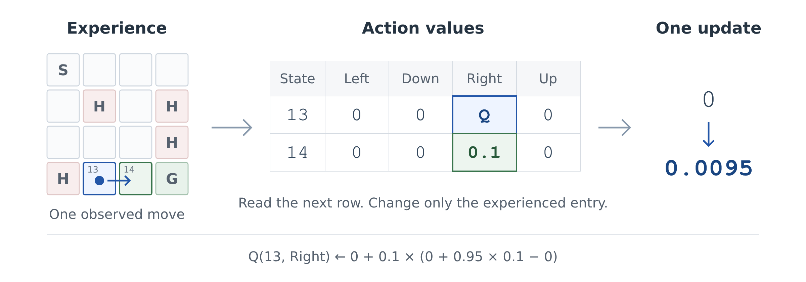
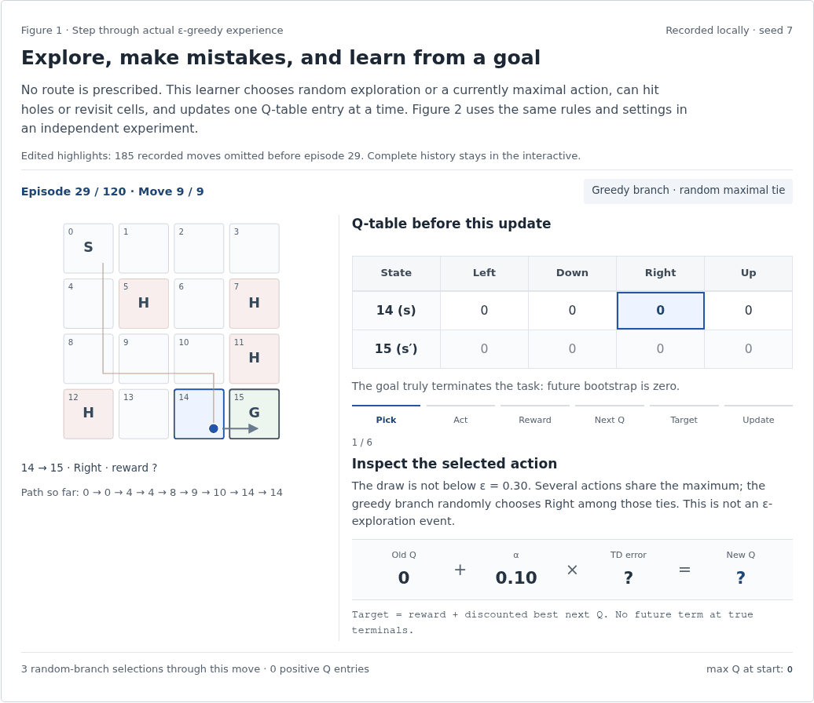
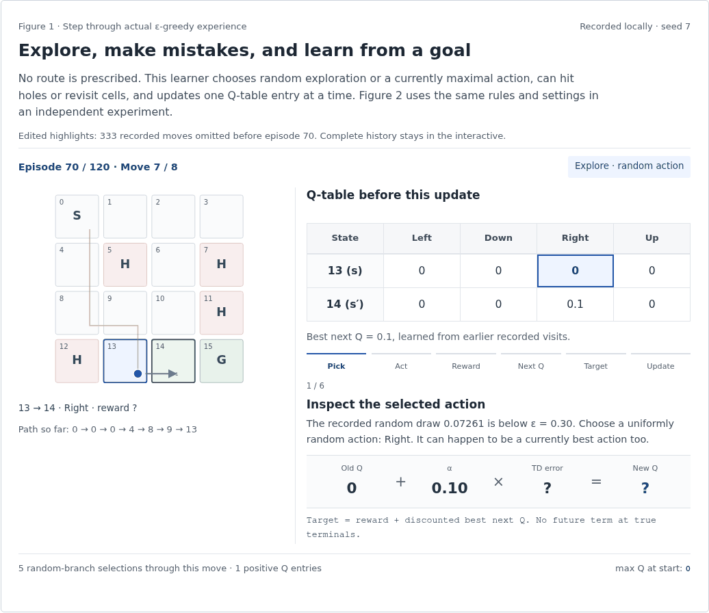
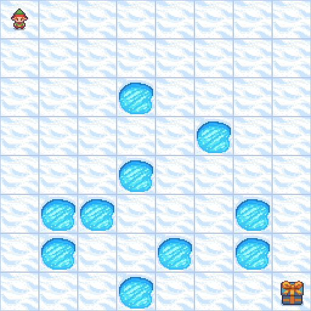

# Q-learning: watch a table learn, one experience at a time



*From a zero-filled table to delayed reward, exploration, and a real FrozenLake agent. Part 1 of RL-from-zero.*

A Q-learning agent does not begin with a route to the goal. It begins with a table of guesses.

Every row is a state. Every column is an action. Their intersection asks: **How much discounted future reward could taking this action lead to?** The agent acts, sees what happened, and revises the entry for that experience.

There is no neural network hiding in this example. Its small, local corrections are enough to demonstrate some of reinforcement learning's most important ideas: exploration, bootstrapping, off-policy targets, and the difference between a successful policy and a fully learned value function.

The [interactive companion article](https://AlirezaShamsoshoara.github.io/blog/rl-from-zero/q-learning/) lets you inspect individual transitions and run a separate learner. This version explains the same mechanism without requiring any interactive controls.

## First, give the table a world

Our teaching world is a deterministic four-by-four FrozenLake-style map:

```text
S F F F
F H F H
F F F H
H F F G
```

`S` marks the start, `F` a safe tile, `H` a hole, and `G` the goal. States are numbered 0 through 15, left to right across each row. Four action columns follow **Left, Down, Right, Up**.

Entering the goal gives reward **1**. Every other transition gives **0**. A hole or the goal truly ends the episode. A boundary can keep the agent in its current cell without ending the task. Actions do not slip to a different direction.

Position is enough to identify the state here. That is not a universal rule: a different task may also need velocity, inventory, or time remaining to predict its next outcome.

Write the value of an action as `Q(s, a)`. The table initially has no evidence favoring one direction over another. In the repository, its construction is straightforward.

**Table construction, inside `QLearningAgent.__init__`. This excerpt belongs to the surrounding class, not a standalone training program.**

```python
import numpy as np

self.Q = np.zeros((self.n_states, self.n_actions), dtype=np.float32)
```

The teaching world needs a 16-by-4 table. The repository's larger default FrozenLake task needs 64-by-4. Both use the same tabular idea.

## Three knobs, three different jobs

- **Alpha, the learning rate**, determines how much of a correction is applied now.
- **Gamma, the discount**, determines how later reward counts relative to nearer reward.
- **Epsilon, the exploration probability**, determines how training collects experience.

These are not interchangeable ways to make an agent more adventurous. Alpha changes learning, gamma changes the objective, and epsilon changes the behavior that supplies data.

The teaching recording uses alpha **0.1**, gamma **0.95**, epsilon **0.3**, and seed **7**. It contains **120 episodes and 843 actual transitions**, including wall moves, revisits, holes, and goals. No successful route is prescribed to it.

Its first three episodes take 12, 5, and 4 moves, respectively, and all end in holes. Those failures are part of the learning story, not footage removed to make the learner look successful.

## Reward is not return

A reward is the immediate feedback from one transition. A return adds the rewards that follow, with discounting:

```text
G_t = r_(t+1) + gamma * r_(t+2) + gamma^2 * r_(t+3) + ...
```

The first reward counts fully; each additional step adds another factor of gamma. True termination ends the sum. When gamma is below one, an otherwise identical reward contributes more if received sooner.

Q-learning aims to estimate the expected return from an action followed by optimal behavior. A Q-value is therefore not generally a success percentage. Its scale depends on rewards and discounting, and its current estimate can be incomplete or wrong.

The agent does not wait to observe the entire future before updating. Instead, it combines a reward it just received with an estimate already in its table. Learning partly from another estimate is **bootstrapping**.

## The update in three lines

For a continuing transition, read the next state's row and take its maximum. For true termination, add no continuation.

```text
target   = reward + gamma * (1 - terminated) * max_a' Q(s', a')
TD error = target - Q(s, a)
Q_new    = Q_old + alpha * TD error
```

Here `terminated` is 1 when the task truly ends and 0 otherwise. `s'` is the observed next state. **TD** means temporal difference: the gap between the current estimate and this new, one-step target.

A positive gap raises the estimate. A negative gap lowers it. A zero gap leaves it unchanged. With alpha 0.1, the agent takes one tenth of the correction rather than replacing its prediction with the target.

**Only the experienced state-action entry is updated.** Reading the next row does not rewrite it, and one move does not replace the entire current row.

## The first useful reward

The recording begins with a random exploration action: **Up from state 0**. The boundary keeps the agent in place. Reward, old estimate, and next maximum are zero, so the update is also zero.

The first goal does not arrive until **episode 29**. The agent takes **Right from state 14 to state 15**. Right is action index 2. This particular action was chosen by randomly breaking a tie among maximal values, not by the epsilon exploration branch.

Goal entry earns 1 and terminates. The update is:

```text
target = 1
TD error = 1 - 0 = 1
Q_new(14, Right) = 0 + 0.1 * 1 = 0.1
```



*This short clip shows the first goal transition in the recorded teaching run. It is not a complete training episode or a benchmark result.*

Now one final action has a positive estimate. The start has not instantly learned a route. Earlier actions were observed before that estimate existed, and reaching the goal does not retroactively replay them.

## How zero reward can still teach something

In **episode 70**, the agent revisits **state 13, Right, state 14**. This safe move gives reward 0, but state 14 now has a best estimate of 0.1.

```text
target = 0 + 0.95 * 0.1 = 0.095
TD error = 0.095 - 0 = 0.095
Q_new(13, Right) = 0 + 0.1 * 0.095 = 0.0095
```



*This is a later recorded revisit. The intervening episodes supplied its next-state estimate; these two clips are not consecutive transitions in a new zero-table run.*

The correction comes entirely from predicted continuation, not an extra reward for a safe tile. Later visits can carry the information farther back. In this recording, a start-state action first gains value in **episode 103**, becoming approximately **2.863e-6**.

That is small, but nonzero. The interactive display uses scientific notation so a tiny estimate is not mistaken for an exact zero. These episode numbers describe one fixed-seed teaching run, not a universal learning budget.

Zero immediate reward alone does not imply a zero update. What matters is the **TD error**, which also includes the current estimate. A zero residual can mean that both prediction and target are still missing useful downstream evidence; it does not certify convergence.

## Exploration and greedy ties are different

Epsilon-greedy training selects a uniformly random action with probability epsilon. Otherwise, it selects a maximizing action. When several actions tie, the repository randomly chooses among those maxima during training.

An action can therefore look random for two different reasons:

1. The epsilon exploration branch chose it.
2. The greedy branch broke a tie among equally valued actions.

Tie-breaking is not an epsilon event. Conversely, the exploration branch can pick a currently best action, so epsilon is not the probability of making a visibly different choice.

For deterministic evaluation, the repository uses the first argmax and neither consumes randomness nor advances the exploration counter.

**Action selection, excerpt from `act` after state validation.**

```python
if deterministic:
    return int(np.argmax(self.Q[state]))
self.global_step += 1
if np.random.rand() < self.epsilon():
    return int(np.random.randint(self.n_actions))
candidates = np.flatnonzero(self.Q[state] == np.max(self.Q[state]))
return int(np.random.choice(candidates))
```

The browser experiments keep epsilon fixed until a control changes. The repository's training recipe instead decays it with training steps. Decay can shift collection toward exploitation, but too-rapid decay can leave useful routes undiscovered.

## Why the target is off-policy

Suppose the next exploratory action will be Down, while Right has the largest next-state Q-value. Q-learning still uses Right's value in its target.

The data-collecting behavior can explore, but the update evaluates the **best continuation**. That separation makes Q-learning off-policy. SARSA, by contrast, uses the value of the next action actually selected.

Off-policy does not mean data coverage becomes irrelevant. Unobserved state-action pairs cannot teach the table what their outcomes are.

The [pinned agent implementation](https://github.com/AlirezaShamsoshoara/RL-from-zero/blob/27ea78dc267363afec2d447f1ba0278bfccdf89e/Qlearning/ql/agent.py) maps this distinction directly into code.

**One-cell update, excerpt after index and reward validation.**

```python
target = float(tr.r) + (
    0.0 if tr.done else self.gamma * float(np.max(self.Q[next_state]))
)
td_error = target - float(self.Q[state, action])
updated = float(self.Q[state, action]) + self.alpha * td_error
self.Q[state, action] = updated
```

`Transition.done` means true termination in this implementation. Returned statistics expose the target, residual, and updated value, which explain the correction more clearly than reward alone.

## A loop stopping is not always a task ending

A goal or hole truly ends FrozenLake. Suppress the future term, but still learn from that terminal reward.

An external interaction cap can instead interrupt an underlying continuing task. Retain bootstrap from the **final observed next state**, not the reset state of the next episode. The repository updates first, then stops its loop.

If a deadline is intrinsic to the task, it may be a genuine terminal event. A finite-horizon state may also need time remaining. Decide what the task means before deciding its mask; a library's loop-stop flag is not the whole objective.

## The real repository task: FrozenLake 8×8

The small world makes arithmetic inspectable. [RL-from-zero's default recipe](https://github.com/AlirezaShamsoshoara/RL-from-zero/blob/27ea78dc267363afec2d447f1ba0278bfccdf89e/Qlearning/configs/frozenlake.yaml) runs the same tabular idea in Gymnasium's deterministic **FrozenLake-v1 8×8** environment.

It has **64 states and four actions**, with goal-only reward 1 and terminal holes. The recipe uses alpha **0.1**, gamma **0.99**, a **200-step cap**, and **5,000 training episodes**. Its seed is 42, and exploration decays from 1 to 0.05. NumPy performs the learning on CPU; PyTorch is used for checkpoint serialization, not a neural network.



*Native Gymnasium rendering from the repository's committed GIF. It contains three selected repeats of the saved policy, not AI-generated footage or the small browser experiment.*

The saved Q-table was selected at **training episode 1,011**, using a ten-episode training-return window. A subsequent unfiltered evaluation reached the goal in **200 of 200 episodes**, each taking **16 moves**, without updating the table.

All repetitions used the **same fixed map and start state**. They establish repeatability of that policy here, not independent-map generalization, slippery-dynamics robustness, shortest-path optimality, or convergence of every entry.

To reproduce the repository recipe, use a separate working copy and a fresh named environment. Training writes new checkpoints; it is not required merely to replay an existing trusted table.

```bash
uv venv .venv-qlearning-medium
source .venv-qlearning-medium/bin/activate
uv sync --active

WANDB_MODE=offline OMP_NUM_THREADS=1 MKL_NUM_THREADS=1 \
  uv run --active python -m Qlearning.main train \
  --config Qlearning/configs/frozenlake.yaml
```

The [repository README](https://github.com/AlirezaShamsoshoara/RL-from-zero/blob/27ea78dc267363afec2d447f1ba0278bfccdf89e/Qlearning/README.md) explains checkpoint evaluation, headless rendering, and GIF export. Keep an evaluator's complete episode report separate from a selected showcase.

## What a successful route does not prove

Finite discounted tabular Q-learning has convergence results under assumptions including bounded rewards, repeated state-action coverage, and suitable learning rates. Along each pair's updates, a standard requirement is that learning rates sum to infinity while their squares sum to a finite value.

A constant alpha of 0.1 does not satisfy that decreasing-rate condition. It can be useful in practice, but a finite run and a successful greedy route do not prove every Q-value converged. Separate observed policy performance from coverage and theory.

A table is wonderfully transparent, but it needs an entry for every state-action pair and does not generalize a correction to separately indexed similar states. **DQN** keeps the reward-plus-continuation idea and replaces the lookup table with a neural network. Shared parameters and moving bootstrapped targets introduce new stability problems; a tabular convergence argument does not simply carry over.

Before adding that complexity, keep one picture: **an experience arrives, a target is formed, and one estimate moves toward it**. Here, you can point to the exact cell.

## References and companion material

- [Interactive Q-learning companion](https://AlirezaShamsoshoara.github.io/blog/rl-from-zero/q-learning/): recorded exploration, Q-table inspection, and an independent parameter experiment.
- Watkins and Dayan, *Q-learning* (1992), [doi:10.1007/BF00992698](https://doi.org/10.1007/BF00992698).
- Sutton and Barto, *Reinforcement Learning: An Introduction*, second edition, [canonical book page](http://incompleteideas.net/book/the-book-2nd.html), especially Chapter 6.
- [Pinned RL-from-zero source](https://github.com/AlirezaShamsoshoara/RL-from-zero/blob/27ea78dc267363afec2d447f1ba0278bfccdf89e/Qlearning/ql/agent.py).
- [Gymnasium FrozenLake documentation](https://gymnasium.farama.org/environments/toy_text/frozen_lake/).
