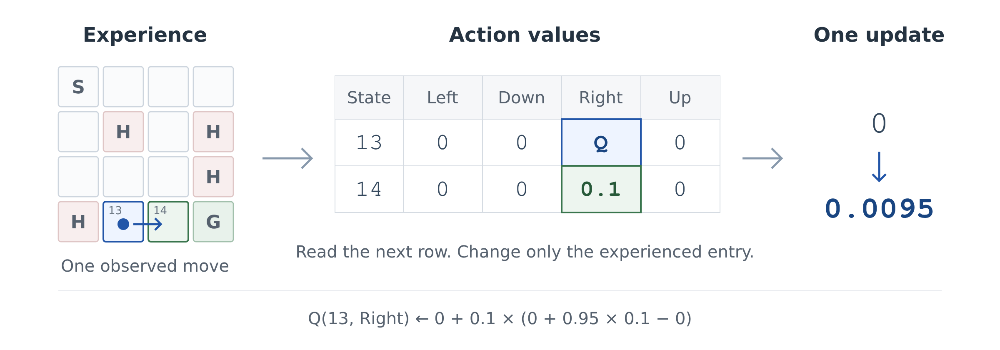
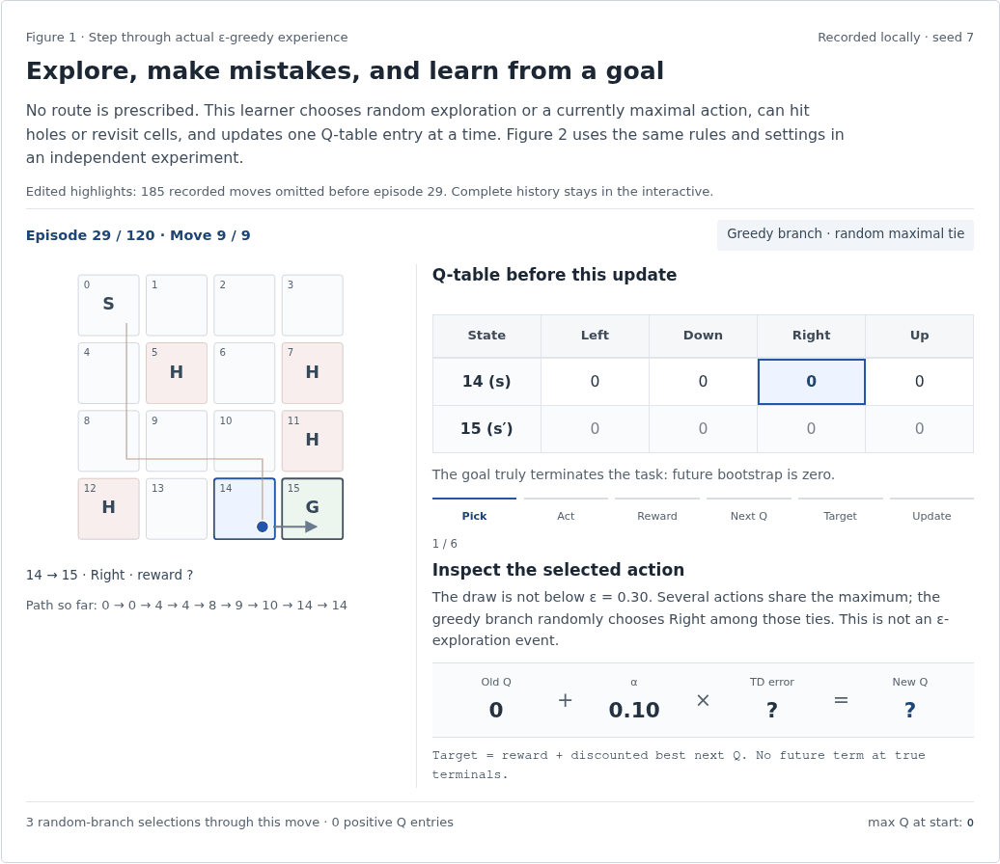
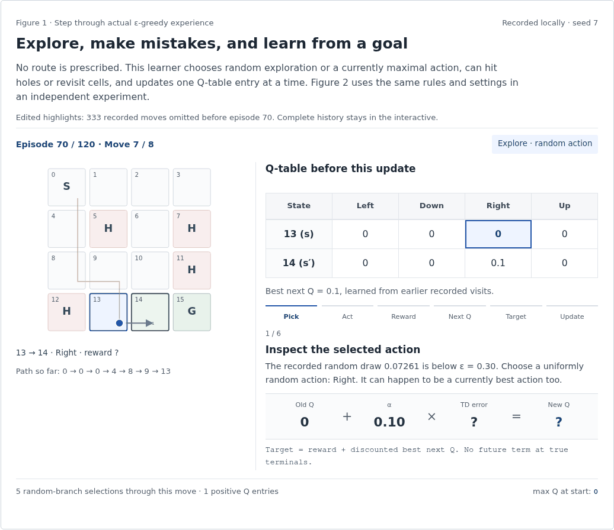
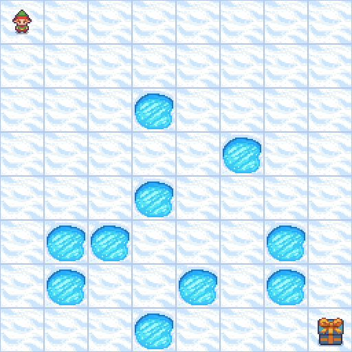

# Q-learning: how a table learns from a delayed reward


*Most moves earn nothing. A few local corrections can still teach an agent where a distant reward might be found.*

The agent's first move goes nowhere.

It is standing in the upper-left corner of a frozen lake. Exploration chooses Up, but the boundary keeps it in the same tile. The reward is zero. Its estimate for that action remains zero too.

If you watched only this moment, you might conclude that nothing happened. Yet this is a genuine interaction: an action was selected, an outcome observed, and a prediction checked. Later, the same learning rule will turn a reward at the far end of the lake into useful estimates closer to the start.

No neural network is required. The learner keeps a table. Let's follow the evidence into it, without pretending the failures never happened.

## One mental model: a ledger of predictions

Each row in the table represents a state. Each column represents an action. The entry `Q(state, action)` estimates how much future reward taking that action could lead to, followed by optimal choices afterward.

Our teaching world is a deterministic 4 by 4 FrozenLake-style map:

```text
S F F F
F H F H
F F F H
H F F G
```

`S` is the start, `F` a safe tile, `H` a hole, and `G` the goal. States run from 0 to 15, left to right across each row. Actions are Left, Down, Right, Up, indexed 0, 1, 2, 3.

Entering the goal earns 1. Every other transition earns 0. Holes and the goal truly end the task; directions do not randomly slip.

An episode is one attempt from the start. Resetting the agent's position between attempts does **not** erase its table. That distinction is what allows later experience to build on earlier experience.

In the [pinned RL-from-zero agent](https://github.com/AlirezaShamsoshoara/RL-from-zero/blob/27ea78dc267363afec2d447f1ba0278bfccdf89e/Qlearning/ql/agent.py), the ledger begins like this:

**Code: zero-table construction inside `QLearningAgent.__init__`.** This excerpt requires the surrounding agent object; it is not a standalone program.

```python
import numpy as np

self.Q = np.zeros((self.n_states, self.n_actions), dtype=np.float32)
```

Sixteen states and four actions mean 64 predictions. Zero is an initial guess, not proof that an action is worthless. A state must also contain what matters for predicting the next outcome. A tile identifier suffices here; other tasks might need velocity or time remaining.

## Reward is not return

A reward is feedback from one transition. A **return** adds up future rewards, discounting those farther away:

`return = next_reward + gamma * following_reward + gamma^2 * reward_after_that + ...`

True termination ends that sum. With gamma below one, an otherwise identical reward contributes more when it arrives sooner. A Q-value estimates expected return, not a success percentage or a promise about the next attempt.

Three settings have separate jobs:

- **Alpha, α, is the learning rate.** It controls how much of a correction is applied now.
- **Gamma, γ, is the discount factor.** It controls how later rewards contribute to the objective.
- **Epsilon, ε, is the exploration probability.** It controls when training chooses a uniformly random action instead of a maximizing action.

Our default trace uses alpha 0.1, gamma 0.95, epsilon 0.3, and seed 7. Epsilon stays constant in this teaching experiment. Across 120 episodes, the learner records 843 actual transitions, including wall moves, revisits, holes, and goals. No route is supplied.

## The engine fits in three lines

After observing an action's reward and next state, Q-learning constructs a target, measures a gap, and corrects the old estimate:

```text
target = reward + gamma * (1 - terminated) * max_a' Q(next_state, a')
TD_error = target - Q(state, action)
Q_new(state, action) = Q_old(state, action) + alpha * TD_error
```

Here `a'` ranges over next-state actions. `terminated` is 1 for a true terminal transition and 0 otherwise. **TD** means temporal difference: the gap between the old prediction and this one-step target.

A positive gap raises the estimate; a negative gap lowers it. Alpha 0.1 applies one tenth of the gap. Only the experienced state-action cell changes. Reading the next row does not rewrite it or update the entire route.

Using an existing next-state estimate to help build a new estimate is **bootstrapping**.

**Code: the agent's one-cell update.** The surrounding method supplies validated indices and a `Transition`; `tr.done` means true termination, not an external time limit.

```python
target = float(tr.r) + (
    0.0 if tr.done else self.gamma * float(np.max(self.Q[next_state]))
)
td_error = target - float(self.Q[state, action])
updated = float(self.Q[state, action]) + self.alpha * td_error
self.Q[state, action] = updated
```

## Two moments, with real experience between them

The first episode ends after 12 moves in hole 7. The second lasts five moves and the third four; both end in hole 5. Those are not failed attempts removed from a polished success montage. They belong to the learning history.

The **first goal arrives in episode 29**: state 14, Right, state 15. The reward is 1 and the transition is terminal, so the target is just 1. The old entry is zero:

- Target: **1**.
- TD error: `1 - 0 = 1`.
- New value: `0 + 0.1 * 1 = 0.1`.

The final action gains value. Earlier actions do not instantly inherit its reward.



*First-goal clip: one observed transition in episode 29, selected by random tie-breaking among maximizing actions. The calculation above remains readable even if an email shows only the first frame.*

The **first positive zero-reward bootstrap arrives in episode 70**. Epsilon exploration chooses Right from state 13 into safe state 14. Reward is still zero, but the next row now contains the previously learned 0.1:

- Target: `0 + 0.95 * 0.1 = 0.095`.
- TD error: `0.095 - 0 = 0.095`.
- New value: `0 + 0.1 * 0.095 = 0.0095`.



*First-bootstrap clip: one observed transition in episode 70. It follows intervening episodes and updates, not immediately after the clip above. Its snapshot retains that experience; these clips are not continuous training or evaluation statistics.*

By episode 103, a start-state action first gains value: exploration chooses Down from 0 to 4, raising its estimate from zero to approximately `2.863e-6`. This rounded, tiny signal reflects many sampled visits. Credit travels through **later observed revisits**, not an instantaneous backward sweep.

## Random-looking actions have different causes

The first goal's action came from a maximizing tie; the first bootstrap's action came from the epsilon branch. Both involved randomness, but they are different decisions.

Epsilon-greedy training selects a uniformly random action with probability epsilon. Otherwise it selects a currently maximizing action, breaking ties randomly. Tie-breaking is not an epsilon-exploration event. Conversely, the epsilon branch can pick an action that was already best.

For deterministic evaluation, the repository uses the first maximum instead:

**Code: action selection from `act`, after state validation.** This method excerpt is not independently executable. Evaluation returns before training advances its counter or samples randomness.

```python
if deterministic:
    return int(np.argmax(self.Q[state]))
self.global_step += 1
if np.random.rand() < self.epsilon():
    return int(np.random.randint(self.n_actions))
candidates = np.flatnonzero(self.Q[state] == np.max(self.Q[state]))
return int(np.random.choice(candidates))
```

There is another important separation. Suppose exploration will choose Down next, while Right has the largest next-state Q-value. Q-learning's target still uses Right's value. It learns about the best continuation while collecting exploratory experience, making it **off-policy**. SARSA, by contrast, evaluates the next action actually selected.

For a closer look, [Try the interactive version](https://AlirezaShamsoshoara.github.io/blog/rl-from-zero/q-learning/). One figure inspects individual sampled transitions; another runs an independent learner in 500-episode batches. They share settings, not tables. Changing alpha, gamma, or epsilon resets both histories; no learned values are copied between them.

## A real repository environment, not just arithmetic

The repository's native `FrozenLake-v1` recipe uses the deterministic 8 by 8 map, `is_slippery: false`, with 64 states and four actions. Alpha remains 0.1, but gamma is 0.99 and the cap is 200 steps, versus 0.95 and 60 in the browser lesson.

The stock recipe budgets 5,000 episodes, seed 42, and step-based epsilon decay from 1 to 0.05 at rate 0.001. Learning uses a CPU NumPy table; PyTorch handles checkpoint serialization, not neural-network training.



*Native environment showcase: a copy of the repository's committed GIF, with three selected repeats of the same 16-move saved-policy route. It is environment rendering, not generated video or a benchmark extracted from selected clips.*

The saved checkpoint was selected at episode 1011 using a ten-episode training window. A fresh evaluation, **without further training**, reached the goal in 200 of 200 unfiltered episodes, each taking 16 moves, with the Q-table unchanged. All used the **same fixed map and start**. The stock control matched the result; this is not a measured improvement or evidence of robustness to new maps or slippery dynamics. Nor is the route claimed to be shortest.

To train the repository recipe, use a separate working copy and install its dependencies in a fresh named uv environment as described in the [pinned README](https://github.com/AlirezaShamsoshoara/RL-from-zero/blob/27ea78dc267363afec2d447f1ba0278bfccdf89e/Qlearning/README.md). From the repository root with that environment active:

```bash
WANDB_MODE=offline OMP_NUM_THREADS=1 MKL_NUM_THREADS=1 \
  uv run --active python -m Qlearning.main train \
  --config Qlearning/configs/frozenlake.yaml
```

*Training command: offline W&B preserves local metrics without uploading. Training creates new checkpoints; replaying the supplied checkpoint does not require retraining. This command does not promise identical outcomes or GIF bytes.*

## What a good-looking table cannot prove

A zero TD error means the observed target and estimate agree. Both may be zero because useful downstream evidence has not arrived. A successful replay likewise says little about unvisited states or alternative actions.

Finite tabular convergence results require assumptions: a finite Markov setting, bounded rewards, repeated state-action coverage, and appropriate per-pair learning rates. Standard discounted conditions require those rates to sum to infinity while their squares sum to a finite value. Constant alpha 0.1 is useful experimentally, but does not provide that formal guarantee.

Terminal semantics matter too. Holes and the goal suppress bootstrapping. An artificial interaction cap stops collection without necessarily ending the task, so use the final observation's continuation value, not a reset observation. If a deadline is intrinsic to the task, reaching it may truly terminate; the state may need time remaining. Do not decide the objective from a loop-stop flag alone.

### Sources and further reading

- Watkins and Dayan, [Q-learning](https://doi.org/10.1007/BF00992698) (1992).
- Sutton and Barto, [Reinforcement Learning: An Introduction](http://incompleteideas.net/book/the-book-2nd.html), second edition, particularly temporal-difference control.
- RL-from-zero: [pinned agent](https://github.com/AlirezaShamsoshoara/RL-from-zero/blob/27ea78dc267363afec2d447f1ba0278bfccdf89e/Qlearning/ql/agent.py), [training loop](https://github.com/AlirezaShamsoshoara/RL-from-zero/blob/27ea78dc267363afec2d447f1ba0278bfccdf89e/Qlearning/main.py), and [native configuration](https://github.com/AlirezaShamsoshoara/RL-from-zero/blob/27ea78dc267363afec2d447f1ba0278bfccdf89e/Qlearning/configs/frozenlake.yaml).
- Gymnasium, [FrozenLake environment documentation](https://gymnasium.farama.org/environments/toy_text/frozen_lake/).

## Next: replace the ledger, keep the question

A table needs an entry for every state-action pair. That becomes impractical for images or enormous state spaces, and it cannot generalize a correction to separately indexed similar states.

Deep Q-learning predicts action-values with a neural network. The reward, estimated best continuation, and TD gap remain recognizable. Shared parameters, moving bootstrapped targets, replay buffers, and target networks introduce different stability concerns; tabular guarantees do not simply transfer.

Before moving there, ask: **When an early action earns zero, what would have to change downstream for its value to rise on the next visit?** If you can explain that correction, you understand the engine behind the table.
