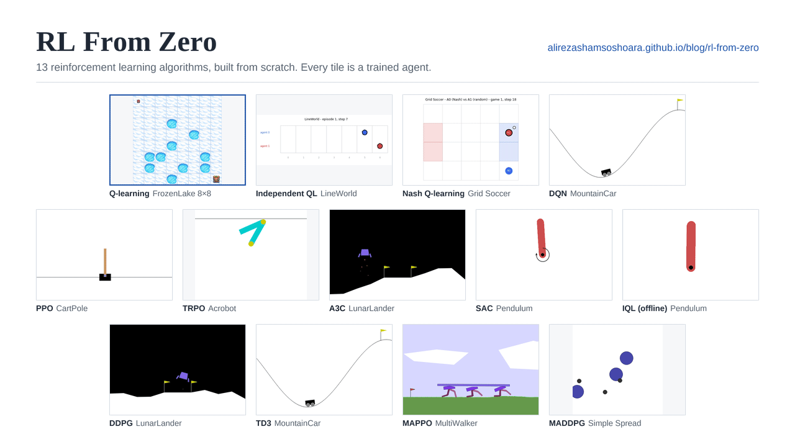

# RL From Zero: reinforcement learning, built from scratch



*Thirteen reinforcement learning algorithms, implemented from scratch and explained one idea at a time. Every tile above is a trained agent.*

Reinforcement learning is easy to describe and surprisingly hard to see. An agent acts, collects a reward, and slowly gets better. The interesting part happens in between: a value estimate that moves a little, a gradient that points somewhere useful, a target that keeps shifting while the agent learns.

RL From Zero is a series that makes those steps visible. Each post takes one algorithm from my open-source [RL-from-zero repository](https://github.com/AlirezaShamsoshoara/RL-from-zero) and walks through how it actually learns, from its first update to a trained agent.

## What is in the repository

Every algorithm is implemented from scratch in its own self-contained package, with the same command-line interface, YAML configuration, and optional Weights & Biases tracking. Each one comes with a trained agent, and the animation above shows all of them in their own environments:

- **Tabular methods:** Q-learning on FrozenLake, plus two multi-agent variants: Independent Q-learning on LineWorld and Nash Q-learning on Grid Soccer.
- **Deep value-based learning:** DQN, with a Double DQN option, on MountainCar.
- **Policy gradients and trust regions:** PPO on CartPole and TRPO on Acrobot.
- **Actor-critic methods:** A3C on LunarLander, DDPG on LunarLander Continuous, TD3 on MountainCar Continuous, and SAC on Pendulum.
- **Offline RL:** IQL (Implicit Q-Learning), trained from a fixed Pendulum dataset.
- **Multi-agent deep RL:** MAPPO on MultiWalker and MADDPG on Simple Spread.

## What each post includes

- **The core idea first**, in plain language, before any equation.
- **Figures and animations** that show the algorithm learning, one step at a time.
- **The math, worked through** with real numbers from a recorded run.
- **The matching code** from the repository, and the commands to train and evaluate it yourself.
- **The real environment**, with the trained agent and a clear note on what the results do and do not show.

## Where it starts

The series begins at the simplest end: a table of Q-values. Part 1, [*Q-learning: watch a table learn*](https://alirezashamsoshoara.github.io/blog/rl-from-zero/q-learning/), follows one experience into one changed table cell, then shows how exploration and a delayed reward turn many small updates into a policy. The version on my blog is interactive, so you can step through every update yourself.

Later posts build from there, toward methods that replace the table with a neural network, learn a policy directly, and coordinate several agents at once.

## Try it yourself

The code is open source under the MIT license. To train the first agent:

```bash
git clone https://github.com/AlirezaShamsoshoara/RL-from-zero.git
cd RL-from-zero
uv venv .venv
uv sync
source .venv/bin/activate
python -m Qlearning.main train --config Qlearning/configs/frozenlake.yaml
```

Every other algorithm follows the same pattern: a YAML config, a `train` command, and a `demo` command that replays the saved agent.

## Follow the series

The [RL From Zero page](https://alirezashamsoshoara.github.io/blog/rl-from-zero/) on my blog lists every post in reading order. Follow me here on Medium to get each new part as it comes out.
