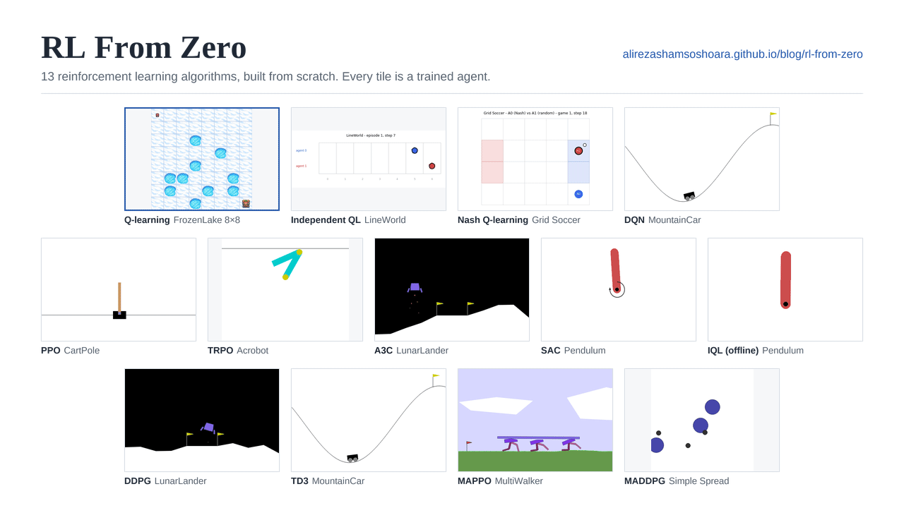

# Introducing RL From Zero



*Reinforcement learning algorithms, built from scratch and explained one idea at a time. Every tile above is a trained agent from the series' open-source repository.*

Thanks for being here. Today I am starting RL From Zero: a series about how reinforcement learning algorithms actually learn.

Most explanations of RL jump from "the agent gets a reward" straight to "and then it works." I want to slow down the part in between: one update, one number that changes, and why it changes. Each post takes one algorithm from my open-source [RL-from-zero repository](https://github.com/AlirezaShamsoshoara/RL-from-zero) and follows it from its first update to a trained agent.

## Thirteen algorithms, one consistent codebase

Every algorithm in the repository is implemented from scratch, with the same command-line interface, YAML configs, and optional Weights & Biases tracking. Each one ships with a trained agent:

- **Tabular:** Q-learning (FrozenLake), Independent Q-learning (LineWorld), Nash Q-learning (Grid Soccer)
- **Deep value-based:** DQN with a Double DQN option (MountainCar)
- **Policy gradients:** PPO (CartPole), TRPO (Acrobot)
- **Actor-critic:** A3C (LunarLander), DDPG (LunarLander Continuous), TD3 (MountainCar Continuous), SAC (Pendulum)
- **Offline RL:** IQL, Implicit Q-Learning (Pendulum dataset)
- **Multi-agent:** MAPPO (MultiWalker), MADDPG (Simple Spread)

## What each post includes

- The core idea in plain language, before any equation
- Figures and animations of the algorithm learning, step by step
- The math worked through with real numbers from a recorded run
- The real code from the repository, and the commands to run it
- The trained agent in its environment, with an honest note on what the results do and do not show

## Part 1 is already on the blog

The series starts with the simplest learner there is: a table of guesses. [*Q-learning: watch a table learn*](https://alirezashamsoshoara.github.io/blog/rl-from-zero/q-learning/) follows one experience into one changed table cell, then shows how exploration and a delayed reward turn many small updates into a policy. The blog version is interactive, so you can step through each update yourself. The next post here brings the full walkthrough to your inbox.

## Try it yourself

```bash
git clone https://github.com/AlirezaShamsoshoara/RL-from-zero.git
cd RL-from-zero
uv venv .venv
uv sync
source .venv/bin/activate
python -m Qlearning.main train --config Qlearning/configs/frozenlake.yaml
```

The code is open source under the MIT license, and every other algorithm follows the same pattern: a YAML config, a `train` command, and a `demo` command that replays the saved agent.

If you know someone who is learning RL, forward this to them. And if there is an algorithm you want me to cover sooner, reply and tell me which one.
